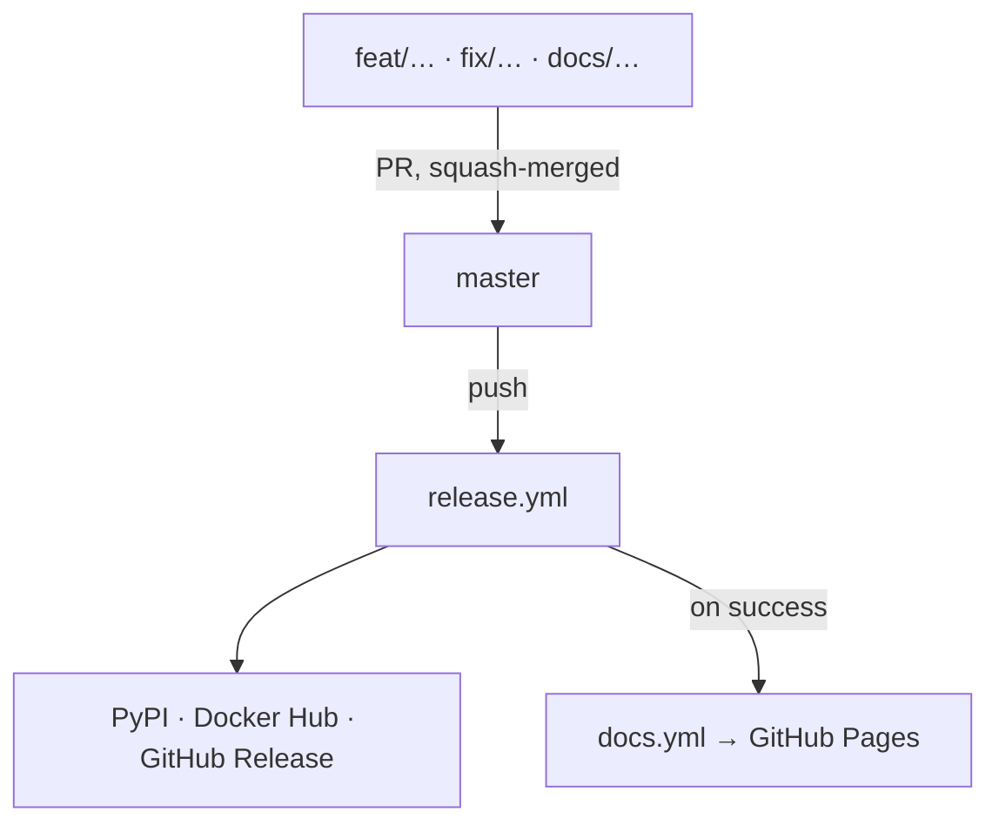

# The pipelines

What runs where, and why it runs there. The branch rules themselves are
[CONTRIBUTING §3](../CONTRIBUTING.md#3-branches); this is the CI side of them.

One rule shapes the whole thing: **a check lives at the cheapest point that can
catch it.** Fast feedback on every pull request, publishing only from `master`.

---

## The flow

`master` is the only long-lived branch, and [rulesets](#rulesets) protect it. Work
reaches it only as a squash-merged PR; the one other writer is the `ci-doctor-release`
GitHub App, which `release.yml` uses to push the version bump and the tag.

| Event | Workflows |
|---|---|
| PR into `master` | `ci` · `conventions` · `security` · `release-gate` |
| push to `master` | `ci` · `security` · `release`, then `docs` on its success |
| weekly cron | `security` |

---

## `ci.yml`

Jobs are independent so one red check names the kind of problem. `all-green` depends on
all of them and is the only `ci` check the ruleset requires, so adding a job or a Python
version never needs a ruleset edit — `tests/test_workflows.py` fails if a job is missing
from its `needs`.

It also runs on every push to `master`. "Branch must be up to date" is off, so what lands
can differ from what the PR tested; the push run checks the result and is the baseline
Sonar compares PRs against.

| Job | Does | Notes |
|---|---|---|
| `test` | `pytest --cov` on Python 3.11–3.14 | `fail-fast: false` — *which* versions break is the useful answer. Coverage lands on the run summary page; the 3.11 leg also uploads `coverage.xml` for Sonar. |
| `lint` | `ruff check` (incl. `S`), `ruff format --check`, markdown formatting, `ty` | `ty` runs over `ci_doctor` only: a type error in the shipped package is what reaches a user. |
| `docs` | `npm run build` of the site | Build only. Publishing is `docs.yml`, so a PR cannot touch what is live. |
| `leaks` | `gitleaks` over the PR's whole history | `fetch-depth: 0` — a secret added and then removed is still a leak. The CLI, pinned by checksum, not gitleaks-action: the action needs a licence secret for an organisation, which fork and Dependabot PRs never get. |
| `sonar` | SonarQube Cloud analysis, with the coverage from `test` | Its steps skip without `SONAR_TOKEN` and the job still passes: fork and Dependabot PRs get no secrets. Its quality gate is informational for now. |
| `all-green` | Fails unless every job above succeeded | `if: always()`, so a failed or cancelled job turns it red instead of leaving it pending. |

## `conventions.yml`

A squash merge makes the PR title the commit on `master`, and `release.yml` reads its type
to decide whether to ship, so the title is what must be a Conventional Commit. commitlint
checks it against the same `.commitlintrc.yml` the git hooks use, and the job checks the
branch is `<type>/<slug>` (Dependabot's own branches excepted).

It is its own workflow because renaming a PR fires only the `edited` event. In `ci.yml`
that event would re-run the whole suite on every description edit — and re-running from
the Checks tab reuses the old title.

## `security.yml`

Separate from `ci.yml` for one reason: **the weekly cron**. A CVE is published
after your last commit, so without a schedule it would surface only on whatever
PR happens next — which for a small team can be weeks.

It runs on PRs (where it matters) and on pushes to `master` (the baseline CodeQL compares
a PR against), not on branch pushes: a branch with a PR is covered by the PR run. It is
not a required check — a CVE published today should not block an unrelated PR.

| Job | Does |
|---|---|
| `codeql` | GitHub's dataflow analysis for Python. Findings land in the repo's Security tab. |
| `deps` | `pip-audit` over the locked runtime dependencies, against the OSV database. `--no-dev`: an SBOM and a CVE report should describe what a user installs, not our tooling. |
| `actions` | `zizmor` over the workflow files themselves — script injection via `${{ }}`, over-broad permissions, loose action refs. |

`ruff`'s `S` ruleset (flake8-bandit) is the fourth piece and runs inside `ci.yml`'s
`lint` job, because ruff already vendors it — no extra tool, no extra job.

**zizmor policy.** [`.github/zizmor.yml`](../.github/zizmor.yml) sets `ref-pin`
rather than the default `hash-pin`. Hash-pinning is stricter, but only pays off
with a bot to bump the hashes; without one it just freezes actions wherever they
were the day they were added.

## `release-gate.yml`

Every PR: the packaging `release.yml` will do, minus publishing and Docker.

| Job | Does |
|---|---|
| `distributions` | `uv build` + `twine check` — catches the metadata problems PyPI rejects on upload. |
| `schema` | `ci-doctor config --schema` still generates valid JSON |
| `sbom` | The CycloneDX SBOM generates and parses |

The image is built only by `release.yml`. That is safe because `release.yml` builds
everything before it pushes the tag, so a broken Dockerfile fails the release with nothing
published — the first alpha failed the other way round, tag first. These three stay on PRs
because they are cheap and name the PR that broke packaging.

## `release.yml`

Runs on every push to `master`, but publishes only when there is something to
publish: the `gate` step looks for a `feat`/`fix`/`BREAKING CHANGE` commit since
the last tag. Docs and chores ride along in the next alpha rather than cutting one
of their own.

In order, so that a failure before the push leaves nothing public: bump to the next alpha
in the working tree → build sdist and wheel → log in to Docker Hub → build the image
(loaded, not pushed) and save it as a gzipped tar → generate the config schema → generate
the SBOM → **commit the bump and push it with an annotated tag** (`--atomic`) → attest the
distributions → create the GitHub Release with all assets → publish to PyPI via Trusted
Publishing → push the image to Docker Hub and attest it. Docker Hub is last because it is
optional: an outage there must not hold up PyPI.

**A failure after the tag push** leaves the tag and bump commit public. "Re-run failed
jobs" does not recover it — the re-run checks out the original commit and bumps again —
so finish the remaining steps by hand from the tag (`gh release create`, `uv publish` from
a checkout of the tag, `docker push`), or let the next feat/fix ship the next alpha.

**The release App.** The push lands on a protected `master` and creates a protected `v*`
tag, so it authenticates as the `ci-doctor-release` GitHub App, the one actor both
rulesets let through. `actions/create-github-app-token` mints a token scoped to this repo
that expires within the hour. The bump commit ends in `[skip ci]`, which stops it from
re-triggering the pipeline.

**Docker Hub.** Images go to [`fennet/ci-doctor`](https://hub.docker.com/r/fennet/ci-doctor)
as `:<version>` and `:latest`. Note the name differs from the PyPI distribution,
which is `ci-doctorr` — the `ci-doctor` name was already taken on PyPI. The import
package and the command are `ci_doctor` / `ci-doctor` everywhere.

The gzipped tar asset stays on the Release regardless. That is the air-gap path,
and pushing to a registry does not replace it.

**Provenance.** `actions/attest-build-provenance` signs the distributions and the
image digest, so a user can verify what built them. The image attestation is
pushed to the registry alongside the image.

**Caching is off in this job.** A restored cache is writable by any branch's
workflow; in a job that publishes, that trades a few seconds for a wider supply
chain.

## `docs.yml`

Builds `docs/site` and deploys to GitHub Pages. **Triggered by `release.yml`
completing**, not by a push.

That indirection fixes a real bug. The site reads its version from
`pyproject.toml` ([`src/lib/version.ts`](site/src/lib/version.ts)), and
`release.yml` bumps that file *during* its own run, committing it with `[skip ci]`.
Building on the push meant rendering the commit before the bump, so the published
site permanently trailed the latest release by one.

Two details make it work:

- **`release.yml` runs on every push to `master`**, and its "is there anything to
  release?" check is a *step*, not a workflow-level skip. So a docs-only push still
  runs it to completion and still triggers this workflow.
- **The checkout pins `ref: master`.** For `workflow_run`, `actions/checkout`
  defaults to the SHA of the *triggering* run — the pre-bump commit.

Deploys are skipped when the release failed, so the site never advertises a version
that did not ship. `workflow_dispatch` is the manual retry.

---

## Rulesets

Set in the repository settings, not in a file.

**`master`** (the default branch):

- no deletion, no force-push, linear history;
- changes only by PR: one approval from a code owner (`@ci-doctor/maintainers`, see
  `CODEOWNERS`), an approval of the latest push, stale approvals dismissed, review threads
  resolved, squash-merge only;
- required checks: `all-green`, `conventions`, `sdist + wheel build and check`,
  `config schema generates`, `SBOM generates`; branches need not be up to date;
- bypass: the `ci-doctor-release` App (always — the release push) and repository admins
  (on pull requests only — merging a red PR in an emergency, never a direct push).

**`release tags`** (`refs/tags/v*`): only the release App can create, move or delete a
release tag. A tag is what PyPI, Docker Hub and every `uses: …@v…` pin points at.

Renaming a required job means editing the ruleset in the same change, or every PR waits
on a check that never reports.

## Secrets

| Secret | Scope | Used by | Absent behaviour |
|---|---|---|---|
| `RELEASE_APP_CLIENT_ID` | org | `release.yml` | The release stops at the token step: built, nothing published. |
| `RELEASE_APP_PRIVATE_KEY` | org | `release.yml` | As above. |
| `SONAR_TOKEN` | repo (the free plan has no org tokens) | `ci.yml` `sonar` | The job's steps skip and it passes. |
| `DOCKERHUB_USERNAME` | repo | `release.yml` | The push steps skip; the release still completes and the tarball is still attached. |
| `DOCKERHUB_TOKEN` | repo | `release.yml` | As above. Use a Docker Hub access token, not the account password. |

`GITHUB_TOKEN` is provided automatically. PyPI needs no secret — Trusted Publishing
authenticates over OIDC against a publisher configured for this repo and workflow.

---

## Adding a check

Put it where it is cheapest to catch, not where it is easiest to write:

- **Fast, and catches a mistake a contributor makes often** → `ci.yml`, and add the job to
  `all-green`'s `needs`.
- **Security posture, and worth re-running against unchanged code** → `security.yml`,
  so the cron picks it up.
- **Packaging, and only matters at release time** → `release-gate.yml`, and add its name to
  the ruleset's required checks.
- **Produces an artifact users consume** → `release.yml`, built before the tag push, and
  added to the Release assets so it is versioned with everything else.
